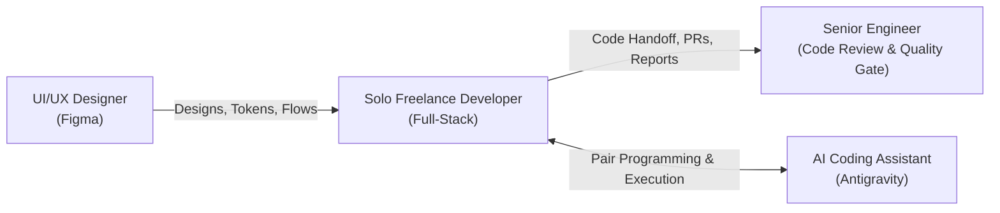

# PROJECT_OVERVIEW.md - Examinations Department (دار الرؤى للتدريب)

> **Document Type:** AI Agent Context & System Architecture Guide  
> **Target Audience:** AI Coding Assistants (LLM Pair Programmers) & Technical Collaborators  
> **Last Updated:** October 2026  

---

## 1. Project Overview & Company Identity

### Organization & Purpose
- **Brand / Entity:** **دار الرؤى للتدريب (Dar Al-Ruya for Training)**, based in the Kingdom of Saudi Arabia.
- **Project Domain:** Psychological, cognitive, behavioral, and personal development assessment platform (منصة المقاييس والاختبارات النفسية والمهنية).
- **Mission:** Empowering individuals, educational institutions, and corporate organizations through scientifically grounded psychological tests, coaching diagnostics, and self-discovery tools to foster self-awareness, personal growth, and career alignment.

### Key Pillars & Core Assessments
1. **عجلة الحياة (Life Wheel):** Interactive self-assessment evaluating personal balance across key life dimensions (career, spiritual, health, financial, family, social, etc.) with dynamic radar/polar visualizations and actionable recommendations.
2. **أنماط الإدراك والتفكير (Perceptual & Cognitive Styles):** Evaluates how users process sensory information (Visual, Auditory, Kinesthetic / بصري، سمعي، حسي).
3. **مفاتيح الشخصية (Personality Keys):** In-depth personality archetype profiling based on behavioral psychology.
4. **Dynamic Assessment Engine:** Admin-configurable questionnaires supporting multiple question types (Likert scale, multiple choice, scenario-based) with weighted multi-dimensional scoring models.

---

## 2. Team Structure & Workflow Dynamics

Understanding who is involved and their responsibilities is critical when assisting on this project:



1. **The Solo Freelance Developer (The User):**
   - The sole engineer building this platform end-to-end.
   - Responsible for both **Backend** (Laravel, architecture, database, APIs, security) and **Frontend** (Blade, Tailwind CSS, UI components, client-side interactions, responsive layout).
   - Any proposed solution must respect developer productivity, avoid unnecessary complexity (YAGNI), and maintain clean, testable architecture.

2. **The UI/UX Designer:**
   - Produces designs and design systems in **Figma**.
   - Strict adherence to Figma mockups is required: RTL layouts, typography (Cairo, El Messiri), precise color tokens (`#204A7A`, `#3B82F6`, etc.), specific desktop/mobile viewports, and non-scrollable auth cards on desktop where designed.

3. **The Senior Engineer (Reviewer / Gatekeeper):**
   - Receives all code handoffs.
   - Demands high code quality: PSR-12 standard, clean separation of concerns, robust error handling, automated test suites (`php artisan test`), and clean Git commit history.
   - Code must never contain quick hacks, missing validations, or undocumented breaking changes.

---

## 3. Technology Stack

| Layer | Technologies & Tools |
| :--- | :--- |
| **Backend Framework** | Laravel 12 (PHP 8.2+) |
| **Database** | MySQL (with migrations, seeders, and factory support) |
| **Landing & Assessments UI** | Laravel Blade templates + Tailwind CSS 3.x + Vanilla JS (Modular ES6) |
| **Admin Dashboard UI** | Laravel Blade + Bootstrap 5 / Custom Admin Theme |
| **Bundler & Build Tool** | Vite (dedicated `vite.landing.config.js` and standard `vite.config.js`) |
| **Authentication** | Custom session/cookie-based auth, Phone/Email verification with OTP, password resets |
| **Testing** | PHPUnit / Pest (`php artisan test`) |
| **Localization & Direction** | Native Arabic (RTL - `dir="rtl"`), UTF-8 encoding |

---

## 4. Repository & File Structure

```
Examinations-Department/
├── app/
│   ├── Enums/                     # Type-safe PHP Enums (e.g. AssessmentStatus, QuestionType)
│   ├── Http/
│   │   ├── Controllers/
│   │   │   ├── Admin/             # Admin panel management (Users, Assessments, CMS, etc.)
│   │   │   ├── AuthController.php # Authentication: Login, Register, OTP verification, Password resets
│   │   │   ├── LandingController.php # Public landing pages, CMS content delivery
│   │   │   ├── LifeWheelController.php # Life Wheel quiz execution and scoring
│   │   │   └── AssessmentController.php # Assessment taking, submission, and result display
│   │   ├── Middleware/            # Custom middleware (Auth, Admin verification, Guest redirection)
│   │   └── Requests/              # Form Requests containing backend validation rules
│   ├── Models/                    # Eloquent Models (User, Assessment, Question, Result, CMS, etc.)
│   └── Services/                  # Business Logic Layer
│       ├── Assessments/           # Calculation & scoring engines (ScoringService, etc.)
│       ├── LifeWheelService.php   # Life Wheel dimension processing and analytics
│       └── UserService.php        # User lifecycle management
├── bootstrap/                     # Laravel bootstrap & app configuration (app.php, providers.php)
├── config/                        # Laravel config files (auth.php, database.php, cms.php, etc.)
├── database/
│   ├── factories/                 # Eloquent model factories for testing
│   ├── migrations/                # Database schema migrations
│   └── seeders/                   # Seeders for default users, assessments, CMS contents
├── public/                        # Public assets, build outputs, favicon, uploaded media
├── resources/
│   ├── css/                       # General application CSS
│   ├── js/                        # General JS entrypoints
│   ├── landing/                   # Public & Assessment Frontend Assets
│   │   ├── css/                   # Tailwind CSS source files for landing
│   │   └── js/                    # Client-side scripts (quiz.js, chart.js, auth-validation.js, etc.)
│   └── views/
│       ├── admin/                 # Admin Blade views (Bootstrap 5)
│       ├── auth/                  # Authentication Blade views (Login, Register, OTP, Reset Password)
│       ├── components/            # Reusable Blade components (Navbar, Modals, Buttons)
│       ├── landing/               # Public-facing Blade pages (Home, Assessments, Life Wheel, Results)
│       └── layouts/               # Master layouts (app.blade.php, landing.blade.php, auth.blade.php)
├── routes/
│   ├── web.php                    # All web routes (Auth, Landing, Assessments, Profile)
│   ├── admin.php                  # Protected Admin dashboard routes
│   └── console.php                # CLI console commands
├── tests/
│   ├── Feature/                   # Feature & integration tests (Auth, Quiz, Scoring)
│   └── Unit/                      # Unit tests for Services & math logic
├── vite.config.js                 # Standard Vite configuration
├── vite.landing.config.js         # Dedicated Vite configuration for landing/Tailwind bundle
└── composer.json                  # PHP dependencies & autoloader
```

---

## 5. Architectural Patterns & Core Business Logic

### A. Two-Layer Validation Strategy
- **Layer 1: Client-Side (Vanilla JS):** Real-time client-side checks for instant feedback (e.g., password matching, phone formatting, required fields) without firing network requests.
- **Layer 2: Backend (Laravel FormRequests):** Strict, authoritative server-side validation. All inputs must be validated before touching Eloquent models or services.

### B. Guest Interception Flow (Take Assessment Gate)
- Unauthenticated visitors browsing the landing page can explore assessments, but **cannot take any assessment** without having an active account.
- Clicking any "Take Assessment" or "بدء المقياس" button intercepts the guest with an interactive **Auth Modal** containing:
  - Direct login credentials input.
  - A highlighted call-to-action: *"إذا لم يكن لديك حساب، أنشئ حساباً سريعاً الآن"* directing to the registration flow.
- Seamless redirection back to the chosen assessment upon successful authentication.

### C. Authentication & Profile Header Flow
- When an authenticated user browses the platform, their header does not show raw text and a plain logout button.
- It displays a sleek profile avatar/icon that triggers a dropdown menu displaying:
  - User's Full Name.
  - Link to "الملف الشخصي" (Profile page).
  - "تسجيل الخروج" (Logout action), which redirects cleanly to the **Home page** (`/`), not the login screen.

### D. CMS & Dynamic Content Architecture
- Public landing pages retrieve dynamic headlines, features, and FAQs via a dedicated CMS layer (`cms()` helper / database-driven content).
- Hardcoding static copy in Blade should be avoided when CMS models exist for that section.

---

## 6. Guidelines for AI Assistants & Pair Programmers

When working on this repository, all AI agents must follow these hard principles:

1. **RTL & Arabic First:**
   - All public and auth views must strictly respect right-to-left orientation (`dir="rtl"`).
   - All user-facing strings, validation messages, and alerts must be natural, professional Arabic (الفصحى المعاصرة).
2. **Strict Figma Fidelity:**
   - Pay close attention to Figma layouts, especially desktop vs mobile behaviors.
   - For auth pages (Login, Password Reset, OTP), maintain full viewport desktop alignment where requested and avoid unnecessary scrollbars.
3. **No Phantom Code or Broken Tests:**
   - Run `php artisan test` after implementing backend or routing changes. Never leave broken tests.
   - Do not invent non-existent database columns or bypass migrations/seeders.
4. **Clean Code & Senior Handoff Ready:**
   - Respect PSR-12 PHP standards.
   - Keep controllers thin by delegating complex calculations to dedicated Services in `app/Services/`.
   - Maintain clear comments where business logic or math is non-trivial.
5. **Concise Communication:**
   - The user values high-efficiency pair programming. Deliver direct, actionable solutions with minimal fluff.
